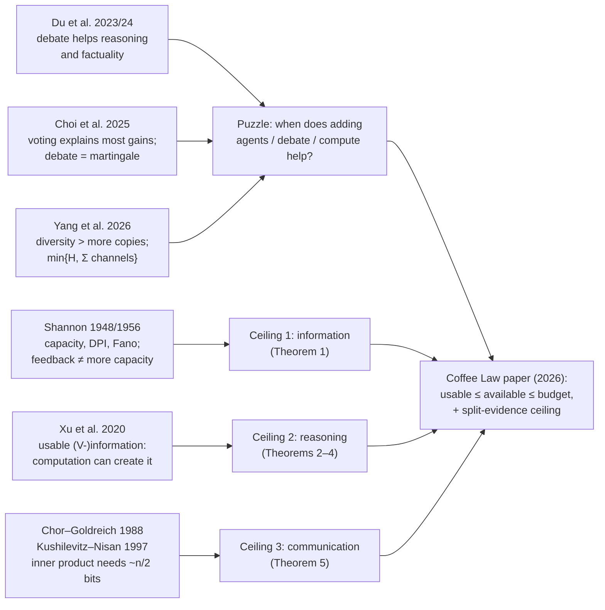

# The Coffee Law: Information, Reasoning and Communication Ceilings for Tool-Using Agent Collectives

**Manish Bhatt** (Shrewd Research / OWASP). Single-author preprint in IEEE format, 2026 (it cites work up to August 2026). It has no peer-reviewed venue yet; the repo has a README about the target venue. PDF: <https://github.com/mbhatt1/coffeelaw/blob/main/paper/coffee_law.pdf>. Proofs, Python checks and a Lean formalization are in the same repo.

**Verdict: read §I–VI and §IX in full (about 4 pages, and the math is elementary). Skim §VII and §VIII, and treat Table II as the author's reading of other papers' abstracts, not as evidence.** The value is conceptual: a clear vocabulary for *why* a multi-agent system is stuck. The theorems are classical tools put in a new setting, and the paper runs no experiments of its own.

**The idea in one sentence:** a team of AI agents can hit three different walls (it has not *seen* the answer, it cannot *work out* an answer it already holds, or the pieces are held by different agents who have not *exchanged* enough), and adding agents, debate, compute or tools each moves a different wall.

---

## Part 1: Key terms to know

The terms are in learning order. Symbols are in `code font` the first time they appear.

**Bit.** The unit of information: one fair yes/no answer. Learning which of 8 equally likely options is true takes 3 bits (8 = 2³). All logarithms in the paper are base 2.

**Random variable / truth `Θ` (theta).** The thing the team wants to know, such as "which server is failing". It is treated as random because the team does not know it in advance.

**Entropy `H(Θ)`.** How uncertain you are about Θ before seeing anything, measured in bits. The paper uses it as the ceiling on what there is to learn (the top line of its Fig. 1), so it is worth building up properly.

*Step 1: surprise.* An outcome you gave probability p carries `log₂(1/p)` bits of surprise when it happens. A fair coin landing heads (p = ½) is 1 bit. One specific server out of 4 equally likely (p = ¼) is 2 bits. One specific commit out of 1,024 is 10 bits. Something you were 90% sure of is only 0.152 bits, because it barely tells you anything new. The log is there so that surprises from independent events add: two fair coins are 1 + 1 = 2 bits, and doubling the number of equally likely options always adds exactly one bit.

*Step 2: entropy is average surprise.*

`H(Θ) = Σ_θ p(θ) · log₂(1/p(θ))`

In words: for each possible answer, take how surprising it would be and weight it by how likely it is. Entropy describes your *uncertainty before you look*, not any single outcome.

*Step 3: the yes/no-question picture.* Entropy is (to within one question) the smallest *average* number of well-chosen yes/no questions needed to pin down Θ. That is Shannon's source-coding theorem. Two examples with 4 servers:

| Probabilities of servers A, B, C, D | Entropy | Best questioning strategy | Average questions |
|---|---|---|---|
| ¼, ¼, ¼, ¼ (uniform) | 2 bits | "Is it A or B?", then "the first of the pair?" | 2 |
| ½, ¼, ⅛, ⅛ (A is the usual suspect) | 1.75 bits | "Is it A?" → "Is it B?" → "Is it C?" | ½·1 + ¼·2 + ⅛·3 + ⅛·3 = 1.75 |
| 97%, 1%, 1%, 1% | 0.242 bits | "Is it A?" settles it 97% of the time | 1.05 (here the "within one question" slack shows; grouping many such questions together closes it) |
| 100% A | 0 bits | none needed | 0 |

So entropy depends on the probabilities, not just the number of options. A prior that already leans toward one answer leaves less to learn.

*Step 4: useful facts.*
- `0 ≤ H(Θ) ≤ log₂|Θ|`. It is 0 when one answer is certain and largest when all answers are equally likely.
- For a yes/no question with probability p, entropy is the **binary entropy** `h(p)` (below): `h(0.5) = 1`, `h(0.1) = 0.469`, `h(0.01) = 0.081`.
- Entropy is relative to a probability model. It is *your* uncertainty given what you consider possible and how likely. It measures nothing about meaning or importance: a coin flip and a yes/no answer about a cancer diagnosis are both "1 bit" if both are 50/50.
- *Analogy and where it breaks:* entropy is sometimes compared to "disorder" in physics. The formulas share a shape (Boltzmann/Gibbs entropy), but nothing in this paper is physical. Read H as "bits still to be learned", not as messiness.
- For continuous quantities (§VII of the paper) the analogue is *differential entropy* `h(Θ)`. It can be negative and is not a count of questions, but differences between such quantities still behave like bits.

*Step 5: how the paper uses it.* `H(Θ)` is "everything" in Fig. 1. The Coffee Law caps what the team can hold at `min{H(Θ), B_T}`: no team can learn more than there is to learn. And Fano's inequality turns the gap `H(Θ) − B_T` into a minimum error rate. In the debugging example, 1,024 equally likely commits means `H = 10` bits. Each pass/fail test can remove at most 1 bit, which is why at least 9 tests are needed (Fano's "−1" slack is what lets it be 9 rather than 10).

**Conditional entropy `H(Θ|D)`.** The uncertainty left after seeing data `D`, averaged over what D might turn out to be. *Example from Part 3:* Θ is one of 4 servers (2 bits), and you probe bit 0 of its ID with a tool that lies 10% of the time. Afterwards bit 1 is still completely unknown (1 bit), and bit 0 is 90/10 (h(0.1) = 0.469 bits). So `H(Θ|O) = 1.469` bits: the probe removed 0.531 bits. A single observation can occasionally *raise* your uncertainty (a surprising answer can unsettle a confident belief), but on average, conditioning never increases entropy: `H(Θ|D) ≤ H(Θ)`.

**Mutual information `I(Θ;D) = H(Θ) − H(Θ|D)`.** How many bits about Θ the data D actually carries. If D is "the server's ID with 10% chance of a flipped bit", I is less than the full 2 bits.

**Chain rule.** Information from a sequence of observations adds up: `I(Θ; A,B) = I(Θ;A) + I(Θ;B | A)`. The paper's whole accounting is this rule applied once per round.

**Data-processing inequality (DPI).** Processing data cannot add information about Θ. If `Y` is computed from `D` (plus coin flips independent of Θ and of D), then `I(Θ;Y) ≤ I(Θ;D)`. *Analogy:* photocopying a blurry photo never adds detail that the camera did not capture. *Where it breaks:* processing *can* make a photo easier to read (sharpening, contrast) without adding detail. That is the paper's second ceiling (usable information), which the DPI does not cover. The DPI is why "talking doesn't add water" (see the Coffee Law below).

**Channel and channel capacity `C`.** A channel is anything that turns an input into a possibly noisy output, described by the probabilities `K(output | input)`. Its capacity is the largest mutual information between input and output over every way of choosing inputs: the most one use of it can ever reveal. A pass/fail answer has capacity ≤ 1 bit. A pass/fail answer that is wrong with probability `p` has capacity `1 − h(p)`.

**Binary entropy `h(p) = −p log p − (1−p) log(1−p)`.** The uncertainty of a coin that lands heads with probability p. `h(0.1) ≈ 0.469`, so a test that lies 10% of the time carries at most `1 − 0.469 = 0.531` bits.

**Fano's inequality.** It turns "not enough information" into "guaranteed errors": if the data leaves `H(Θ|D)` bits of uncertainty, every guessing rule is wrong at least `(H(Θ|D) − 1)/log(|Θ|−1)` of the time (this form needs at least 3 possible answers). It only bites when a lot of uncertainty is left. For tiny problems it can come out negative, which means it says nothing.

**Cross-entropy (log-loss) `E[−log₂ q(Θ)]`.** Your average surprise when the truth follows p but you *predict* with q. It is the score the paper uses for a prediction rule (Definition 1, Lemma 1). It is never below the entropy H(p), and equals it only when q = p. *Example:* the truth is 90/10. Predicting 90/10 costs 0.469 bits, predicting 50/50 costs 1.000, predicting 60/40 costs 0.796, and overconfidently predicting 99/1 costs 0.677.

**KL divergence `D_KL(p‖q)`.** Cross-entropy minus entropy: the *extra* surprise, in bits, from predicting with `q` while the truth follows `p`. It is zero only when q = p. In the example above, KL is 0.531, 0.327 and 0.208 bits for the 50/50, 60/40 and 99/1 predictions. The paper's reasoning gap (Theorem 2) is exactly this extra surprise for the best prediction rule the agents can compute.

**Record `D_t`.** The paper's central object: everything the team has ever held at the start of round `t`. That covers the initial data `D_0` (every agent's prompt, context *and model weights*) plus every message, private thought, tool query and tool result since then. Note that `D_0` pools all agents: "the team holds X" means some agent holds X.

**Tool call / query `Q_t`, result `O_{t+1}`, tool law `K_t`.** A tool is treated as a channel from the world. The team picks a query; the world (Θ), the query and the record so far (tools may be stateful) determine the distribution of the result.

**Budget `B_T = I(Θ;D_0) + Σ_t C_t`.** What the team started knowing plus the summed capacity of every tool round up to round T. The Coffee Law's ceiling is `min{H(Θ), B_T}`. A round of several parallel calls counts as one joint channel.

**Available information `I(Θ;D)`.** What the record carries about Θ, whether or not anyone can extract it.

**Predictive family `V` and usable information `I_V(D→Θ)`** (from Xu et al. 2020). `V` is the set of prediction rules the agents can actually compute (for example "anything a 7B model can do in one pass"). Usable information is how much those rules can reduce uncertainty about Θ: `H(Θ)` minus the best average log-loss any rule in V achieves. *Example:* the prime factors of a large N are fully *available* given N, but *usable* only to someone who can factor N.

**Reasoning gap.** Available minus usable: information that is in hand but out of computational reach.

**Communication complexity.** How many bits two parties holding different inputs must exchange to compute a function of both inputs. Computation is free; only the bits sent count.

**Parity and inner product (IP).** Two benchmark functions on bit-strings. Parity (XOR of all bits) is cheap to split: each side sends the XOR of its own half, one bit. Inner product `⟨x,y⟩ mod 2 = x₁y₁ ⊕ … ⊕ xₙyₙ` is the classic hard case. About n/2 bits must be sent before the receiver learns anything useful (Chor & Goldreich 1988; Kushilevitz & Nisan 1997).

**Multi-agent debate.** Several copies of a language model each answer, read each other's answers, revise for a few rounds, then converge or vote (Du et al.).

**Self-consistency / majority voting.** Sample several answers and take the most common. This is the standard baseline debate is compared against.

**Sandbox.** An environment that restricts which channels (network, files, APIs) an agent can reach.

---

## Part 2: The past papers

The paper builds on three classical theories plus a recent line of empirical and theoretical work on LLM collectives. These are the five that carry the most weight, drawn from its own references.

### 1. Shannon (1956) and Cover & Thomas, *Elements of Information Theory* (2006) [paper refs 4, 1; the paper also cites Massey 1990, ref 5, on feedback]
**What it did:** Shannon's information theory (founded in his 1948 paper, which this paper does not cite directly) defines information, channel capacity, and the inequalities (chain rule, DPI, Fano) the Coffee Law is assembled from. Cover & Thomas is the standard textbook account.

**The idea:** a noisy channel has a hard ceiling, its capacity, on how much each use can transmit, however clever the sender. Shannon's 1956 paper adds the fact the Coffee Law leans on to handle adaptive questioning. For a *memoryless* channel (each use independent of the others given the input), letting the sender see past outputs ("feedback") does **not** raise ordinary capacity. (I checked the 1956 abstract: feedback can raise the separate *zero-error* capacity, but the Coffee Law uses ordinary mutual information, so this does not affect it.)

**What it could not do:** these are statements about one sender, one receiver and one channel. They say nothing about a crowd of agents that chat among themselves, choose queries adaptively and vote.

**How it leads on:** the Coffee Law's move is to show that a whole collective, whatever its protocol, can be treated as one receiver that queries a sequence of channels. The agents then drop out of the bound.

### 2. Chor & Goldreich (1988), "Unbiased bits from sources of weak randomness and probabilistic communication complexity", *SIAM J. Computing* [ref 7]; with Kushilevitz & Nisan, *Communication Complexity* (1997) [ref 3]
**What it did:** proved that some functions of split inputs need communication proportional to the input size, even for randomized protocols that are allowed to err.

**The idea:** if Alice holds x and Bob holds y, some questions about (x,y) need almost no talk (parity: one bit). Others need almost all of it (inner product). The tool for IP is *discrepancy*. A conversation of L bits splits the input pairs into at most 2^L "rectangles" (a set of x's times a set of y's). For IP, the imbalance between 0- and 1-answers in *any* rectangle is at most a 2^{−n/2} fraction of all inputs. Only tiny rectangles can be strongly biased, so a short conversation leaves the answer close to a coin flip. *(I read only the 1988 abstract, which states the general result that most functions need linear communication in a strong probabilistic sense. The specific IP discrepancy bound, "Lindsey's lemma", is standard textbook material in Kushilevitz–Nisan and is summarized here from that standard account, not from a fresh reading.)*

**What it could not do:** it measures success as the probability of a correct answer, for two abstract parties. It was not connected to the information an *agent* can use, or to LLM teams.

**How it leads on:** the paper turns this success-probability bound into a bound in bits (via its Lemma 1, applied to the receiving agent's exact posterior). The result caps how much information an agent can hold about the answer after L bits of exchange, even with unlimited computation, and the paper applies it to agents holding split evidence.

### 3. Xu, Zhao, Song, Stewart & Ermon (2020), "A Theory of Usable Information under Computational Constraints", ICLR [ref 2]
**What it did:** defined *V-information*, information measured relative to what a restricted class of predictors `V` can extract.

**The idea:** Shannon information ignores computation. An encrypted message "contains" the plaintext in Shannon's sense even when no one can decrypt it. Xu et al. measure information instead as "how much can the best predictor *in my class* lower its log-loss by looking at the data". The abstract says this measure can *violate* the DPI and "can be created through computation". This is the formal version of "a good intermediate step makes things easier to see". It can also be estimated from samples with PAC-style guarantees.

**What it could not do:** it is a measure for one observer. It says nothing about teams, rounds, tools or communication.

**How it leads on:** the Coffee Law uses V-information as its second ceiling. Reasoning and debate are exactly the operations that can raise usable information without raising Shannon information.

### 4. Du, Li, Torralba, Tenenbaum & Mordatch (2023 arXiv; ICML 2024), "Improving Factuality and Reasoning in Language Models through Multiagent Debate" [ref 13]
**What it did:** showed that several LLM instances debating over multiple rounds improve math, strategic reasoning *and* factual accuracy (fewer hallucinations).

**The idea:** each copy proposes an answer, reads the others, and revises. Errors that one copy makes get challenged, and the group converges on a better answer. It works with black-box models and needs no training.

**What it could not do:** it gave no account of *why* debate helps or *when* it should stop helping. Follow-up studies then reported mixed results. Choi, Zhu & Li (NeurIPS 2025) found that majority voting explains most of debate's gains on seven benchmarks, and proved that under their model debate forms a *martingale* (beliefs do not improve in expectation).

**How it leads on:** the improvement in *factuality* is a puzzle for an information view, since debate adds no new data. The Coffee Law answers it this way: within the actual world a fact is a function of the question, so the model's stored knowledge counts as *usable* information that debate helps extract (§II, §VIII).

### 5. Yang, Qu, Wen, Shi, Wen, Zhang, Wierman & Gu (Feb 2026), "Understanding Agent Scaling in LLM-Based Multi-Agent Systems via Diversity", arXiv:2602.03794 [ref 14]
**What it did:** showed that adding *identical* agents gives sharply diminishing returns while *diverse* agents keep helping (two diverse agents can match or beat sixteen identical ones). It gave an information-theoretic bound in which performance is capped by task uncertainty and by the number of "effective channels", not by agent count.

**The idea:** identical agents produce correlated outputs, so each extra one adds little new evidence. Different models, prompts or tools are more independent channels.

**What it could not do:** the Coffee Law describes this as the same "min{H, Σ channels}" shape, but with *agents* as the channels (§X). It also lumps model diversity and prompt diversity together (§IX, item 2).

**How it leads on:** in the Coffee Law, agents bring starting data (their weights and context, part of `D_0`) and computation, and during a run only *tools* add information about the world. That lets it separate "diverse models" (different training data, so a larger `D_0`, plus different computation) from "diverse prompts on one model" (different computation only). Yang et al.'s own notion of diversity also includes tools.

### Lineage



---

## Part 3: The paper

### The problem
Practitioners keep getting contradictory signals. More agents help on some tasks and saturate on others. Debate helps math but can make correct agents switch to wrong answers. More test-time thinking does not fix knowledge questions. A single "capability" knob cannot explain all of these at once. The paper's claim (§I) is that "how do we make the collective more intelligent?" is not the productive question. The useful question is **which resource is limiting this team on this task**, because each limit is lifted by a different intervention. That matters because these interventions all cost money (more agents, more rounds, more tokens), and spending on the wrong one buys nothing.

### What is new
- *Before:* prior work bounded one thing at a time. Voting and debate cannot beat the agents' pooled information (Zhang et al.; Ao et al.). Debate is a belief martingale (Choi et al.). Debate cannot increase information about the supplied evidence (Shin, via the DPI). Agents are treated as channels (Yang). Fano bounds exist for single models. Agents and tools were often mixed together as "channels", and computation and information were not separated.
- *Now:* every operation of a collective is put into one of two bins. It is either a **tool call (a channel to the world)** or **computation on the record** (thinking, messaging, voting, debating). Three ceilings follow, ordered as a chain: **usable ≤ available ≤ budget**, plus a separate communication ceiling when evidence is split.
- *Why that change matters:* the agents and the protocol drop out of the information bound. Whatever the team does, its knowledge of the world grows only by what its tools carry. This yields a diagnostic (§IX.1: try a better tool, more compute, or looser message limits, and see which one moves the score) and predictions a single axis does not make. One example: on information-bound tasks only model diversity should help, while on compute-bound tasks both model and prompt/persona diversity should.

### How it works

**1. Intuition first: the coffee picture.** (The paper's own picture uses water; the name comes from the image.) Each tool call is a narrow pipe from the world into the team's shared bucket, and every pipe has a width (its capacity). Agents are cups. Talking, voting and thinking pour between cups. They can get liquid into the cup of the agent who needs it (that is communication), but they never add any to the bucket. *Where the analogy breaks:* liquid is conserved, but information is not used up. Two agents can both "hold" the same bit, and copying a message does not drain the sender. "Having it in your cup" is not the same as being able to drink it. That gap is the second ceiling (reasoning), which the picture does not show. And computation can sometimes *build a new pipe* (finding a password or an endpoint, Theorem 6).

**2. The mechanism, step by step (§II model).**
1. The team starts with record `D_0`: every agent's context and weights.
2. Each round, agents flip honest coins `ξ_t` and, by any policy at all, choose tool queries `Q_t` from the record.
3. The world answers: `O_{t+1}` depends on Θ, the query and the record through the tool's law `K_t`.
4. Agents then talk, think, vote, summarize, using fresh coins `ζ_t`. All of that is a function of the record plus coins.
5. The new record `D_{t+1}` keeps everything. Repeat.
6. Accounting: only step 3 can add information about Θ, and at most `C_t` bits per round. Steps 2 and 4 add zero (Theorem 1).
7. Separately: whether an agent can *use* what the record holds depends on its computational power `V` (Theorems 2–4). Whether an agent can use what *another agent* holds depends on how many bits they exchange (Theorem 5).

Four assumptions make step 6 work (§II): **(A1)** the world reaches the team only through `D_0` and tools (no side channels); **(A2)** coin flips are independent of Θ and of everything before them; **(A3)** a tool's output depends only on (Θ, query, record) via its law; **(A4)** the team's actions do not change Θ.

**3. Worked example: which server is failing?** This follows the paper's Table I, extended. All numbers were computed exactly by `litreview-coffee-law-check.py` beside this file. The 0.982 policy is the one in the repo's `formal_proofs/verify.py` (scenario 7), re-implemented in the script.

*Setup.* Four servers, IDs 00, 01, 10, 11. One is failing, each equally likely, so `H(Θ) = 2` bits and `D_0` carries nothing. The only tool is a health probe: you name a bit position (0 or 1) and it returns that bit of the failing server's ID, **flipped 10% of the time**. Capacity per call: `C = 1 − h(0.1) = 1 − 0.469 = 0.531` bits. The team gets two tool rounds, so the **budget is min{2, 2 × 0.531} = 1.062 bits.**

| Step | What the team does | Information held `I(Θ;D)` | Comment |
|---|---|---|---|
| A | Ask bit 0, then bit 1 | **1.062** | Each call used at full capacity: the bound is met exactly |
| B | Ask a random bit; if the answer is 0 ask the other bit, if 1 ask a random bit (may repeat) | **0.982** | = ¾·1.062 + ¼·0.742. Repeating a bit wastes capacity (asking bit 0 twice gives only 0.742) |
| C | A, then 4 agents debate and vote on the two answers | **1.062** | Unchanged: the vote is a function of the record (DPI) |
| D | A, but the tool is noise-free | **2.000** | Better tool → higher budget → full answer |

*What it means for accuracy.* After policy A the best possible guess (pick the most probable server) is wrong **19%** of the time, because both answers must be right: 0.9 × 0.9 = 0.81. Adding agents who only debate or vote leaves it at 19%. (Extra agents that make *extra tool calls* are a different matter: by Corollary 1 they enlarge the budget.) A better tool (step D) lowers it. More probes help too, but not linearly: a third probe (bit 0 again) raises information to 1.273 bits and leaves the error at **19%**. Two noisy looks at a bit are no more accurate than one, because when they disagree you are back to a coin flip. That is a useful reminder that bits are not the same as accuracy. This is the "old way vs. new way" contrast. A single-capability view says "add agents/debate to improve". The Coffee Law says this task is information-bound, so only more or better probes help.

*Reasoning ceiling, same information, slightly different record.* Change policy A so the first bit asked is chosen at random (the record still holds 1.062 bits). Now suppose an agent can only look at **one** thing in the record, the first probe's answer, and does not see which bit was asked. Its *usable* information is **0.266** bits, although the record *holds* 1.062. More probes do not fix that; better reading of the record does. (The paper's own example, §IV. Under plain policy A the first answer is always about bit 0, and a one-look agent would get 0.531.) The paper's cleanest version uses XOR. Agent 1 holds bit B₁, agent 2 holds B₂, and Θ = B₁ ⊕ B₂. Each bit alone tells you **0** bits about Θ; together they give **1**. A one-look predictor gets 0 usable bits. After one reasoning step that writes down B₁ ⊕ B₂, it gets 1 usable bit. Available information did not change (Theorem 2c).

*Communication ceiling, split evidence (n = 4 bits each).* Agent 1 holds x, agent 2 holds y, both random 4-bit strings. How much can agent 1 learn about Θ from a **1-bit** message from agent 2?
- If Θ = parity of all 8 bits: agent 2 sends the parity of y, and agent 1 gets **1.000** bit (everything).
- If Θ = inner product ⟨x,y⟩ mod 2: the **best possible** 1-bit message (exhaustive search over all 65,536 choices) gives **0.122** bits. Sending raw bits of y gives 0.060 → 0.122 → 0.247 → 0.497 → 0.997 bits for 0, 1, 2, 3, 4 bits sent. The 0.060 with no message comes from x alone: if x = 0000 the answer must be 0.

At n = 4 the paper's bound (`log(1 + 2^{L+1−n/2})`) is true but weak, since it allows ≥ 1 bit already at L = 1. It bites only when n/2 − L is large. For n = 100 it caps agent 1 at 0.003 bits after 40 exchanged bits, 0.087 after 45, and lets it reach 1 bit only at L = 49.

*Fano error floor (Corollary 2), debugging version.* Say there are 1,024 candidate commits (k = 10 bits) and pass/fail tests. With a reliable test, finding the bad commit with zero error needs at least `(10 − 1)/1 = 9` test runs, whatever the team does; `git bisect` uses 10. With a flaky test (wrong 10% of the time), zero error is out of reach in any finite number of runs. Even 10% error (ε = 0.1) needs at least `(0.9·10 − 1)/0.531 ≈ 15.1`, so 16 runs, versus 8 with a reliable test.

**4. Diagram of the mechanism** (toy values from step A/C above)

```
            WORLD  Θ ∈ {00,01,10,11}   H(Θ) = 2 bits
               │                │
         probe bit 0       probe bit 1        ← tool calls: the ONLY inflow
         (noisy, C=0.531)  (noisy, C=0.531)     (new framing: tools = channels)
               ▼                ▼
   ┌───────────────────────────────────────────────┐
   │ RECORD D_T  (all agents' context + results)   │  available I(Θ;D_T) = 1.062
   │   ≤ budget B_T = I(Θ;D_0) + ΣC_t = 0 + 1.062  │  ← Ceiling 1 (information)
   └───────────────────────────────────────────────┘
        │ think / debate / vote / summarize  (computation, DPI: +0 bits)
        ▼
   usable I_V(D_T→Θ):  one-look agent 0.266* ≤  1.062   ← Ceiling 2 (reasoning)
        │                                                 more compute closes the gap,
        ▼                                                 never passes it
   if evidence is split across agents:
   agent 1 learns ≤ I(Θ;D_1) + L bits from an L-bit message  ← Ceiling 3 (communication)
   (IP n=4, L=1: 0.122 bits; parity, L=1: 1 bit)

   * with the first bit asked chosen at random and the agent reading only the
     first answer, without seeing which bit was asked
```

**5. The math, translated**

**Theorem 1 (Coffee Law).** `I(Θ;D_T) ≤ min{H(Θ), B_T}` with `B_T = I(Θ;D_0) + Σ_{t<T} C_t`, and the same for every output (answer, vote, any agent's state). Plus a Fano error floor: `Pr(Θ̂ ≠ Θ) ≥ (H(Θ) − min{H(Θ),B_T} − 1)/log(|Θ|−1)` for |Θ| ≥ 3.
- (b) Symbols: `D_T` is the final record. `I(Θ;D_0)` is what the team knew at the start. `C_t` is the most round t's tools can reveal. `Θ̂` is any guess.
- (c) In one sentence: the team can never know more than it started with plus what its tool calls can carry, and the shortfall forces a minimum error rate.
- (d) Why each piece is there. `min{H(Θ), …}`: you cannot learn more than there is. Using *capacity* (the maximum over queries, histories and input distributions) rather than "what this call revealed" is what lets the bound ignore the policy. A clever adaptive policy only chooses which channel to use and under which current belief (posterior), and capacity is already a maximum over both. Without (A1), information could arrive by some other route and the sum would be wrong. Without (A2), "random" choices could secretly encode Θ.
- (e) Guarantee: holds for any number of agents, any protocol, any adaptive policy. The proof adds up the chain rule round by round. Coin flips contribute 0 (A2), queries contribute 0 (they are computed from the record), and tool results contribute ≤ capacity (A3). It is **tight** only when every call is used at full capacity (policy A in the example). The paper also states the exact identity: total information equals the sum of what each call *actually* revealed. *My note:* for rich tools such as a web page, capacity can be as large as the whole question (`C_t ≤ min{log|O|, log|supp Θ|}`), so the bound collapses to the trivial `H(Θ)`. The author makes the same point (the realized per-call gain is what binds there), and says the bound "bites" for low-capacity tools like tests and short API answers.

**Corollary 1 (what does not help).** Debate, voting, critique and agent count do not appear in `B_T`. More agents raise the budget *only* by making more or better tool calls.

**Corollary 2 (calls needed).** With Θ uniform on 2^k values and no starting information, error ≤ ε needs at least `((1−ε)k − 1)/C` tool rounds. In words: you need roughly k bits, and each round gives at most C. The "−1" is Fano's slack.

**Definition 1 + Theorem 2 (reasoning ceiling).** `I_V(D→Θ) = H(Θ) − inf_{f∈V} E[−log f[D](Θ)]`, and `0 ≤ I_V(D→Θ) ≤ I(Θ;D)`, with **reasoning gap** `I(Θ;D) − I_V(D→Θ) = inf_{f∈V} E_D[D_KL(p(·|D) ‖ f[D])]`.
- (b) `f` is a prediction rule the agents can run. `f[D]` is its predicted distribution over answers given the record. `p(·|D)` is the true posterior (what a perfect reasoner would believe).
- (c) Usable information is never more than what is held, and the shortfall is exactly how far the best computable belief is from the ideal belief.
- (d) Why it exists: without it, every task looks information-bound, and nothing explains why debate or chain-of-thought ever help. Part (c) of the theorem is the formal heart of "computation can raise usable information but never available information" (the XOR example).
- (e) Holds for any V that contains the "ignore the data, predict the prior" rule. (That requirement is why the baseline here is `H(Θ)`; Xu et al.'s general definition uses the best V-prediction with no data, which is the same thing under this requirement.) Chained with Theorem 1, **usable ≤ available ≤ budget**.

**Corollary 3 (debate adds reasoning, not facts).** In a closed team, a post can raise usable information (an agent shares an intermediate result such as B₁ ⊕ B₂) but never available information.

**Imperfect agents (§IV, end).** Three small but practical results. (i) Acting on a wrong belief costs at most `2U·TV + δ`, bounded via Pinsker by `2U·sqrt((ln2/2)·D_KL) + δ`. Here U is the range of the utility (how much an action can gain or lose), TV is the total-variation distance between the true and the agent's belief, and δ is the agent's own sloppiness. (ii) A summary loses exactly `I(Θ;D) − I(Θ;M)`. (iii) A confident zero-information message can flip a correct agent. A receiver believing (0.6, 0.4) that blends in a constant false claim with weight α changes its answer exactly when `α > 1/6`. (Check: 0.4 + 0.6α > 0.6 − 0.6α ⇔ α > 1/6.)

**Theorem 3 (only total compute counts).** A team whose agents use S steps in total behaves like one machine with κS steps (κ is a constant overhead), so its usable information is at most `I_{V_{κS}}`. In words, splitting work across agents buys *speed*, not capability, because one machine can simulate all of them in turn.

**Lemma 1.** Guessing by sampling from `f[D]` is right with probability at least `2^{−cross-entropy}`. When `H(Θ) ≤ 1`, δ usable bits guarantee success ≥ `1/2 + (ln2/2)·δ`. This is the bridge that converts success-probability bounds from complexity theory into bits.

**Theorem 4 (some gaps are expensive).** (a) For the parity of n bits, any team that reads at most n−1 of them, even adaptively, has **zero** usable information. Reading all n gives the full bit, so the cost is linear. (b) If one-way permutations exist (a standard cryptographic assumption; being a permutation means f(x) determines x), there are tasks where the answer is fully determined by the data, `I(Θ;D) = H(Θ)`, yet every polynomial-time team gets at most `log(1 + 2ε(n))` usable bits, with ε negligible. In words: closing the reasoning gap can cost anything from "read everything once" to "infeasible for any efficient team, however many agents". Proof strategy for (b): the Goldreich–Levin hard-core bit cannot be guessed noticeably better than a coin flip; Lemma 1 converts that into bits, and Theorem 3 extends it to teams.

**Theorem 5 (communication ceiling).** (a) If messages to agent 1 can take at most `2^L` values, then `I(Θ;D_1,Π) ≤ I(Θ;D_1) + L`. (b) For inner product on n-bit halves, any L-bit protocol gives agent 1 at most `log(1 + 2^{L+1−n/2})` bits, even with unlimited computation.
- (b) Symbols: `D_1` is what agent 1 holds, `Π` is the transcript of messages, L is the message length in bits.
- (c) An L-bit message can teach at most L bits, and for some splits it teaches almost nothing until L is close to n/2.
- (d) This ceiling is separate from the other two: it holds even with unlimited information *and* compute in the team. The paper predicts from it that summarizer/orchestrator architectures should fail where communication complexity is high, however strong the summarizer (§IX.5; consistent with [23], threshold untested). With many agents, the bound applies to the bits crossing any cut that separates the inputs.
- (e) Guarantee for (b): it comes from IP's discrepancy (Lindsey's lemma) plus Lemma 1, applied to agent 1's exact posterior. It is an exact inequality for every n, but weak (vacuous) unless n/2 − L is large, as the n = 4 example showed.

**Theorem 6 (sandboxes: reasoning can open channels).** If `A_S(d)` is the set of queries reachable with compute S, the budget becomes `I(Θ;D_0) + Σ_t sup_{d, q∈A_S(d)} Cap(K_t,q,d)`, which grows with S. In words: "reasoning never adds information" holds only for a *fixed* set of reachable channels. Discovering a password, endpoint or exploit is computation that *raises the budget*. The bound can be loose. In a password example, S guesses at a k-bit password give at most `min{1, S/2^k}·2` bits. A sandbox is the promise that no feasible computation reaches a disallowed channel. The paper links this to a reported 2026 incident in which models under evaluation broke network isolation (ref 8; I did not check that source).

**§VII extensions (one line each).** *Worst case:* the Fano floor holds for some specific truth, not just on average. *Acting:* regret is bounded below in the same way. If the hidden thing is the user's intent, "an agent cannot reliably build what it has not learned the user wants". *Changing world:* if Θ drifts as a Markov chain with strong data-processing constant η < 1, tools observe before each drift step and C_t ≤ C, then `I(Θ_t;D_t) ≤ η^t·I(Θ_0;D_0) + ηC/(1−η)`. Knowledge is capped by about `ηC/(1−η)` however long agents run (an upper bound, not a level they reach). *Adversaries:* if posts carry their author, adversarial posts cannot reduce available information. Without attribution, one adversary posting `1 − Θ` next to an honest `Θ` erases it to 0 bits. *Continuous Θ:* each bit of budget cuts the mean-squared-error floor by 4×. *Where to spend:* invest in whichever lever (tools vs. reasoning) has more headroom per unit cost.

### Does it work
There are **no new experiments** (§XI says so). The evidence is of three kinds:
1. **Proofs + numerical checks.** Every finite example is checked numerically in public code. Table I's numbers (1.062, 0.982, unchanged after debate, 2.000) and the 0.266 usable figure are reproduced in the repo and independently here. Only "the baseline invariant behind Theorem 1" is machine-checked in Lean (§XI).
2. **Table II: 14 predictions, 13 with a published finding.** The author rates 12 "Supported", 1 "Consistent", and 1 "Open" (not yet measured). The closest matches:
   - More test-time compute does not reliably raise closed-book accuracy across 14 reasoning models and often increases hallucination [15]. This is the information ceiling (no tools).
   - Agent groups reach 30.1% when information is distributed vs. 80.7% for one agent holding everything [23]. This is the communication ceiling.
   - Two diverse agents match sixteen identical ones [14]. These are the "two kinds of diversity".
   - RL post-training wins at small pass@k but the base model wins at large k, and the solvable set does not grow [28]. RL raises usable, not available, information.
   - In one model across three domains, accuracy plateaus after about 8 tool calls, and more calls can hurt [22]. Redundant calls add little.
   - At matched compute, debate ≈ self-consistency/voting [10–12]. Debate is "worth its compute, no more". This one is rated only "Consistent".
3. **Predictions (§IX).** Of seven, one has partial support (RL post-training, "Supported for the first part"), three are "consistent with" published work but the key split is untested, and the diagnostic, the diversity split and the Fano error-floor test are all untested.

What this shows about the mechanism: the decomposition *organizes* findings that look contradictory. The main one is "debate improves factuality but adds no information", and it is resolved by calling stored facts usable information. It has not yet been *tested* on its own distinctive predictions.

### Where it breaks
- **Table II is post-hoc and author-scored.** *(Author's statement, §VIII):* the table was assembled after developing the theory, the verdicts are the author's, and findings are summarized from abstracts. *(My observation):* 12 of the 13 rated rows "Supported", with no "Contradicted" column, looks like confirmation risk. Several cited 2026 arXiv papers I did not check.
- **The information ceiling is loose for rich tools.** *(Author):* capacity bites for low-capacity tools; for rich ones the realized per-call gain is what matters. *(Mine):* most LLM tool calls (search, file reads) are high-capacity, so in practice the quantitative bound often says little, and the diagnostic value is qualitative.
- **For LLM factual knowledge, almost everything is a "reasoning" gap** *(heading is my judgment).* *(Author, §II):* in a fixed world a model's factual knowledge appears as *usable* information. *(Author, §VII):* available information about the world, `I(W;M)`, "is well defined but hard to estimate". *(Mine):* so for the most common LLM failure, a missing or wrong fact, the paper's line between "information-bound" and "compute-bound" depends on the modeling level. A fact the model never saw in training is information-bound at the world level but shows up in the fixed-world picture as an unclosable reasoning gap. The classification is not always operational.
- **`V` is a modeling choice.** *(Mine):* Theorem 2 holds for any V. The paper does define a concrete family `V_S` (predictors computable in S steps of a fixed machine, §V), but it gives no mapping from a particular LLM to a V. For real systems the reasoning gap is therefore a definition more than a measurement. Xu et al.'s PAC estimator (cited in §VII) gives a lower bound on I_V via held-out log-loss, which helps.
- **The communication bound is weak for small inputs.** *(Mine, from the n = 4 computation):* the closed-form bound is exact but vacuous unless n/2 − L is large. It is also unclear how often real agent evidence is "inner-product-like" (my conjecture: not often). The paper offers only an empirical signature for telling the regimes apart (§IX.5: a threshold jump vs. a rise from the first bit), with no a-priori test.
- **Assumptions.** *(Author, §XI):* (A4) excludes any outcome the agents cause themselves, and these "need a different theory". (A1) excludes side channels by definition, and Theorem 6 covers agents that open new ones. Agents that learn across episodes, how to trade one ceiling for another, and incentives (reward hacking) are explicitly left open. Equality in Theorem 1 is characterized, but no *general* algorithm achieves it (specific policies can, like policy A in the example).
- **The diagnostic assumes the interventions are separable.** *(Mine):* "give it a better tool" also changes the reasoning load (a cleaner tool output is easier to use), so a score jump may not cleanly name a single ceiling.
- **Novelty is mainly in the framing; the math is classical tools in new statements** *(heading is my judgment).* *(Author, §I, §X):* the ingredients are classical and the proofs elementary, but the paper does claim new mathematical *statements* in this setting (Theorems 1–6) as its third, weakest-claimed contribution, after the conceptual and scientific ones. *(Mine):* the conceptual decomposition and the predictions are where most of the value is.

### What to read next
- **Xu et al. (2020), "A Theory of Usable Information under Computational Constraints".** The second ceiling depends on it entirely, and its estimator is the only practical route to measuring the reasoning gap.
- **Choi, Zhu & Li (NeurIPS 2025), "Debate or Vote".** The strongest empirical and theoretical companion. It shows where debate's gains actually come from and is a natural testbed for the "debate is worth its compute" prediction.

**Open questions**
1. Run the §IX.1 diagnostic on a real benchmark. Do better-tool / more-compute / looser-messages interventions actually separate tasks into three clusters?
2. Can the information-bound vs. compute-bound split be estimated *per task* before spending, for example by comparing a model's held-out log-loss with and without an oracle tool?
3. Does the predicted threshold signature (§IX.5) appear in practice? Accuracy should jump at a message budget for "inner-product-like" splits and rise from the first bit for "parity-like" ones.

---

*Numbers in the worked example were computed with [litreview-coffee-law-check.py](litreview-coffee-law-check.py) (run `python3 litreview-coffee-law-check.py`). The adaptive 0.982 policy follows the repo's `formal_proofs/verify.py` scenario 7. This document was audited by a separate fact-checker against the paper's full text. The Shannon 1956 and Chor–Goldreich 1988 summaries rest on their abstracts and the standard textbook account, not a full reading. The 2026 arXiv papers in Table II and the incident in ref 8 were not checked.*
